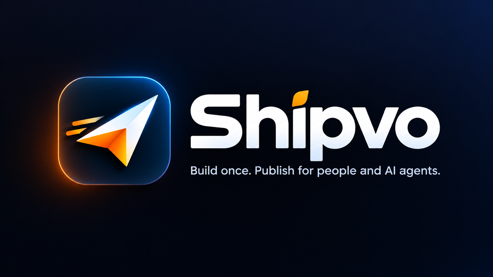

<p align="center"></p>

# Shipvo: build once, publish for people and AI agents

**One React Native app, two places it runs.** People get a native Android or iOS app from the stores, kept current with signed over-the-air updates. AI agents get the same release in a phone-sized simulator they can see and operate over MCP, with no device, including native features (camera, location, biometrics, payments, notifications). Every claim about the simulator is measured against real Android and iOS and published.

> Shipvo was briefly called PureNative. The hosted control plane is `api.shipvo.dev` and the hosted simulator `sim.shipvo.dev`; the older `purenative.workers.dev` addresses keep answering for apps whose shell was built against them.

Three pillars:

1. **Publish.** Signed OTA updates (64 KB patches, crash-loop rollback, staged rollouts), a built-in owner admin at `/app/<id>/admin`, and a control plane you can self-host on Cloudflare.
2. **Simulate.** `@shipvo/mcp` opens any Shipvo app for an agent: accessibility tree with refs, tap/type/scroll/back, screenshots. `@shipvo/device` gives apps one device API, real on phones and simulated in the simulator, with Android- and iOS-worded system sheets the agent answers like a person. Simulation is explicit: every simulated event is logged as simulated and no simulated payment or fingerprint is ever presented as real.
3. **Verify.** The parity harness runs the same flows on the simulator, an Android emulator and an iPhone simulator and compares every screen. Current result: 100% matching controls on both platforms across two purchase flows and 94% across a third flow that uses the camera, location and payment prompts, with the orders themselves compared (`docs/parity-results.md`, which also says exactly what the score does and does not measure).

[](https://github.com/shipvo/shipvo/actions/workflows/ci.yml)
[](https://github.com/shipvo/shipvo/actions/workflows/deploy-control-plane.yml)
[](LICENSE)


> **Status:** pre-launch, measured. OTA numbers come from a real low-end phone (Redmi 9A, 2 GB RAM): `docs/spike-results.md`. Agent results: `docs/agent-gate-results.md`. Simulator-vs-device parity: `docs/parity-results.md`. Native-feature parity (camera, location, permissions, payment prompt) is measured on Android; iOS is next.

## Why Shipvo

Every change to a native mobile app normally means a new build, a store submission, a review, and then waiting for users to update. Many never do. Shipvo separates what has to go through the store from what doesn't:

| Layer | Ships through | Contains |
| --- | --- | --- |
| **Native shell** | App Store / Google Play | Native modules, declared permissions, the signing trust root |
| **Core runtime** | Over the air, signed | The app's JavaScript (Hermes bytecode) |
| **Screens and add-ons** | Over the air, signed | New screens, features and fixes built on capabilities the shell already declares |

Updates are interpreted JavaScript running on native capabilities the shell declares up front. The app never asks for a permission it hasn't declared.

## Features

- **Signed OTA updates:** Ed25519 signatures, verified natively on the device against a public key built into the app. An update can't replace its own trust root.
- **Integrity checks:** SHA-256 and size are verified before a bundle is staged; staging is atomic.
- **Crash-loop protection:** a release that fails to boot 3 times is discarded automatically, and you can roll back to the previous release in one call.
- **Staged rollouts:** cohort bands (1%, 10%, everyone) served as static signed pointers from the edge, with no device registry.
- **Telemetry for every release:** applied, reverted, cold-start time, download size and time.
- **Control plane on Cloudflare Workers:** KV, D1 and R2. It's self-hostable, with a Docker target planned.
- **Admin per app** at `/app/<id>/admin`: live content, prices, offers, orders, history, publish to every phone in seconds; the same typed owner commands are available to agents with a token.
- **Agent-operable apps:** every app exposes typed commands and a UI simulator; `@shipvo/mcp` plugs both into Claude, Cursor, Claude Code or PiPilot.
- **Simulated device:** `@shipvo/device` runs camera, location, biometrics, payments, notifications, share and network on phones (Expo modules) and in the simulator (system sheets in the accessibility tree, state set by the agent). Each capability declares its support level: real, simulated or unavailable.
- **Design skill:** a runnable theme generator, screen checker and anti-generic lint in `skills/shipvo-design`.

## Start

```bash
npx -y @shipvo/cli init myshop && cd myshop && npm install && npx playwright install chromium
npm run sim                      # the app in the simulator; agents: open_app("myshop") through @shipvo/mcp
npx expo run:android             # the native shell; push to main to publish over the air
```

Guides: [Build your first app](docs/getting-started.md) · [Device API](docs/device-api.md) · [Agents and MCP](docs/agents.md) · [Self-hosting the control plane](docs/self-hosting.md) · measured results: [OTA on a 2 GB phone](docs/spike-results.md), [simulator vs device parity](docs/parity-results.md), [agent gate](docs/agent-gate-results.md).

## Use an app as an AI agent (no phone)

Add the MCP server to Claude, Claude Code, Cursor or PiPilot:

```json
{ "mcpServers": { "shipvo": { "command": "npx", "args": ["-y", "@shipvo/mcp"] } } }
```

Then: `open_app("tide@latest")` returns a phone-sized session and the first screen as an accessibility tree with refs; `tap`, `type`, `scroll`, `back` and `screenshot` act on it; `set_device` decides what the phone has (a barcode in front of the camera, a location, whether the fingerprint matches, whether a payment is approved, network off); `device_log` reports every device event, all marked simulated; `end_session` returns the steps taken and the orders the app sent. `tide@r13` opens exactly the release phones are running; `tide` opens a local build. Full tool list: `packages/mcp/README.md`.

What the agent sees is what a person with a screen reader would: only the items of a rail that are on screen (swipe to see more), nothing behind a modal sheet, system dialogs worded as Android or iOS word them.

## How a release reaches phones and agents

```
shipvo publish              Build Hermes bundle → SHA-256 → bsdiff patches → sign pointer (Ed25519)
        │                   Build web artifact of the same commit (platform adapters only)
        ▼
Cloudflare edge             /p/{app}/{shell_major}/{band}.json   (signed envelope, ETag)
        │                   /b/{app}/r{release}.hbc              (immutable bundle, bsdiff patches)
        │                   /w/{app}/r{release}/                 (the same release for agents)
        ├──────────────────────────────┐
        ▼                              ▼
Device runtime (Kotlin)        Simulator / sim.shipvo.dev
verify → download → verify     open_app("tide@r13") → accessibility tree
→ stage → reload → healthy     → tap/type/scroll → device sheets → report
or revert after 3 failed boots
        ▼
Telemetry                   POST /t → D1;  orders POST /o/{app} → D1
```

## Repository layout

| Path | What it is |
| --- | --- |
| `packages/schema` | Contracts: shell manifest, add-on manifest, release pointer, signed envelope, gate report, change log, telemetry (Zod) |
| `packages/cli` | `shipvo` CLI: `init` a new app, `sim` it, `publish` / `rollback` signed releases, signing keys |
| `packages/runtime` | `@shipvo/runtime`: the native OTA runtime (verify, patch, stage, apply, crash-loop rollback) and the config plugin that pins the trust root |
| `packages/sim` | `@shipvo/sim`: the simulator (phone-sized headless browser, accessibility tree, simulated device, mock backend) |
| `packages/mcp` | `@shipvo/mcp`: the MCP server agents use to open, see and operate apps, control the simulated device, and run owner commands |
| `packages/device` | `@shipvo/device`: one device API (camera, location, biometrics, payments, notifications, share, network), real on phones, simulated in the simulator, plus Metro aliases for raw Expo imports |
| `services/control-plane` | Hono worker on Cloudflare: pointers, bundles, web artifacts, content, orders, telemetry, admin, owner API |
| `services/sim` | Hosted simulator Worker: one sandbox per API key, the same MCP tools over HTTPS (sim.shipvo.dev) |
| `services/site` | shipvo.dev: landing page and the public app marketplace |
| `apps/tide-and-tackle` | Sample shop app built on the packages above, plus the device drivers and the parity harness (`sim/`) |
| `docs/` | Measured results: spike, agent gate, parity |
| `skills/shipvo-design` | Design skill with runnable checks |

## Try the sample app

1. Download the latest `tide-and-tackle-shell.apk` from [Releases](https://github.com/shipvo/shipvo/releases) and install it on an Android 7+ phone.
2. Edit `apps/tide-and-tackle/src/release.ts` and push to `main`. The `publish-ota` workflow signs and publishes the release.
3. The app checks every 10 seconds while open, verifies the update, applies it, and logs the timings on screen.
4. Change prices or the home screen at `/app/tide/admin` on your control plane; the phone shows it in about 10 seconds.
5. Open the same release as an agent: `cd apps/tide-and-tackle && pnpm sim`, then `open_app("tide@latest")` through `@shipvo/mcp`, or `scripts/ui screen` from a terminal.

## Develop

```bash
pnpm install
pnpm -r test
pnpm --filter @shipvo/control-plane dev
```

Requires Node 22 and pnpm 10.

## Compared with other OTA tools

Shipvo sits alongside tools like Expo Updates (EAS Update) and self-hosted CodePush servers, which replaced Microsoft App Center CodePush after it was retired in 2025. What Shipvo adds: a declared-capability shell manifest, signed add-ons, a per-app admin, cohort rollouts from static edge files, and apps that AI agents can operate.

## License

Framework: [Apache-2.0](LICENSE). The hosted control plane may be offered under a source-available license; self-hosting stays permitted.
